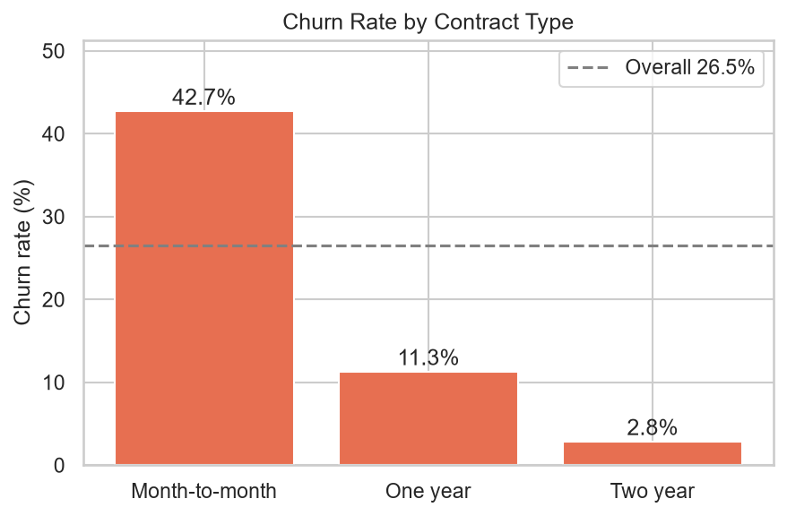
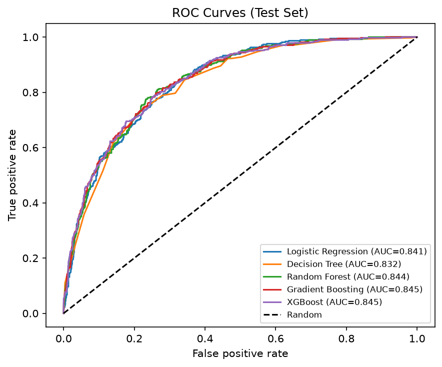
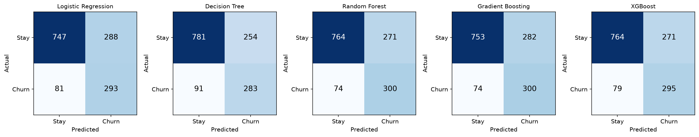
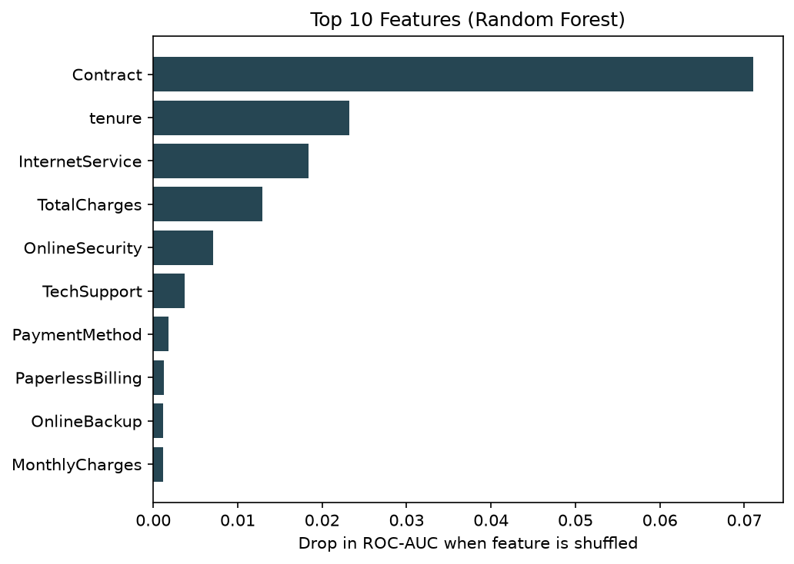

# AI-Based Customer Churn Prediction and Retention Analytics

An end-to-end machine learning project that predicts which telecom customers are likely to leave, explains the main factors behind each prediction, recommends retention actions, and presents everything through a full-stack web app, a Streamlit app, and a Power BI dashboard.


> MCA Minor Project | Artificial Intelligence and Machine Learning

## Table of contents

- [Overview](#overview)
- [Features](#features)
- [Dataset](#dataset)
- [Results](#results)
- [Tech stack](#tech-stack)
- [Project structure](#project-structure)
- [Getting started](#getting-started)
- [Running the web application](#running-the-web-application)
- [Power BI dashboard](#power-bi-dashboard)
- [Testing](#testing)
- [How the parts connect](#how-the-parts-connect)
- [Limitations](#limitations)
- [Author](#author)

## Overview

Acquiring a new customer costs far more than keeping an existing one. This project builds a churn prediction system that:

1. Cleans and explores the IBM Telco Customer Churn dataset.
2. Trains and compares five classification models using a leak-free scikit-learn pipeline.
3. Scores customers with a **risk score**, a **risk level** (Low / Medium / High) and the **main contributing factors**.
4. Suggests **retention actions** backed by real rates from the dataset.
5. Stores predictions and retention cases in **SQLite**.
6. Exposes everything through a **React + Express** web application, with a Streamlit app and a Power BI dashboard as alternatives.

## Features

**Machine learning**
- Five models compared: Logistic Regression, Decision Tree, Random Forest, Gradient Boosting, XGBoost
- Stratified train/test split (seed 42) and 5-fold cross-validation
- Model chosen by a rule fixed in advance (highest mean cross-validated F1)
- Class-imbalance handling, threshold analysis, permutation feature importance
- Out-of-fold scoring so dashboard risk levels are not inflated

**Web application** (React + Express)
- JWT login with bcrypt-hashed passwords, rate limiting and two roles (admin, analyst)
- Dashboard with KPI cards and cross-filtering charts
- Predict page with an animated risk gauge, factor explanation and a live **what-if simulator**
- Customers table with server-side search, filters, sorting and pagination
- Retention work queue with status workflow (New, Contacted, Offer sent, Retained, Lost), notes and CSV export
- Batch scoring: upload a CSV, validate rows, download scored results
- Model performance page (metrics, ROC curves, confusion matrices, feature importance)
- Light/dark themes, responsive layout, Ctrl+K command palette

**Data and analytics**
- SQL schema and analytical queries (`database/`)
- EDA notebook with 14 figures and interpretations
- Power BI dashboard with DAX measures guide

## Dataset

[IBM Telco Customer Churn](https://www.kaggle.com/datasets/blastchar/telco-customer-churn): 7,043 customers, 21 columns, 26.54% churn rate. The raw CSV is included at `data/raw/telco_churn.csv`.

## Results

| Model | Test recall | Test precision | Test F1 | Test ROC-AUC |
|---|---|---|---|---|
| Logistic Regression | 0.783 | 0.504 | 0.614 | 0.841 |
| Decision Tree | 0.757 | 0.527 | 0.621 | 0.832 |
| Random Forest | 0.778 | 0.533 | 0.633 | 0.843 |
| Gradient Boosting | 0.802 | 0.515 | 0.628 | 0.845 |
| **XGBoost (selected)** | 0.783 | 0.520 | 0.625 | 0.846 |

The five models perform very similarly. XGBoost was selected by the pre-defined rule (highest mean 5-fold cross-validated F1 on the training data). Full numbers are in [`reports/model_comparison.csv`](reports/model_comparison.csv). Re-training with different library versions may change the last decimal places.

The strongest drivers of churn, by permutation importance, are **contract type** and **tenure**, followed by internet service type and charges.

### Sample figures

| Churn by contract | ROC curves |
|---|---|
|  |  |

| Confusion matrices | Feature importance |
|---|---|
|  |  |

## Tech stack

| Layer | Tools |
|---|---|
| Data and ML | Python, pandas, NumPy, scikit-learn, XGBoost, joblib |
| Visualisation | Matplotlib, Seaborn, Power BI |
| Database | SQLite |
| Backend | Node.js, Express, better-sqlite3, JWT, bcryptjs, helmet |
| Frontend | React, Vite |
| Alt. interface | Streamlit |
| Testing | pytest, Node test runner |

## Project structure

```
churn-project/
├── data/
│   ├── raw/telco_churn.csv            original dataset (never edited)
│   └── processed/                     cleaned data + Power BI export
├── notebooks/01_eda.ipynb             exploratory data analysis
├── src/
│   ├── config.py                      paths, column lists, constants
│   ├── data_loader.py                 load and clean data
│   ├── preprocessing.py               split + scaling/encoding pipeline
│   ├── eda.py                         reusable EDA plots and tables
│   ├── train.py                       train, cross-validate, compare, save model
│   ├── evaluate.py                    metrics and evaluation plots
│   ├── predict.py                     validation, prediction, risk level, factors
│   ├── retention.py                   retention recommendations + segment analysis
│   ├── database.py                    SQLite access (INSERT/SELECT/UPDATE/DELETE)
│   ├── score_customers.py             out-of-fold scoring, DB load, Power BI export
│   ├── ml_worker.py                   Python worker used by the Node server
│   └── sql_demo.py                    CRUD demo and analytical queries
├── webapp/
│   ├── server/                        Express API, auth, DB, ML worker bridge
│   └── client/                        React (Vite) front end
├── app/app.py                         Streamlit application
├── database/                          schema.sql, queries.sql, churn.db
├── models/churn_model.joblib          saved pipeline + model
├── powerbi/                           dashboard (.pbix), theme, build guide
├── reports/                           metrics CSVs and figures
├── tests/                             pytest suite
├── docs/                              report, paper, synopsis, slides
├── run_pipeline.py                    runs every step in order
├── requirements.txt
└── requirements-tested.txt            exact versions the project was tested with
```

## Getting started

### Prerequisites

- Python 3.10, 3.11 or 3.12
- Node.js 20 or 22 LTS (for the web application)

### Installation

```bash
git clone https://github.com/ashish8847/<your-repo>.git
cd <your-repo>

python -m venv venv

# Windows (PowerShell)
venv\Scripts\activate
# macOS / Linux
source venv/bin/activate

python -m pip install --upgrade pip
pip install -r requirements.txt
```

> On Windows, if activation is blocked, run once:
> `Set-ExecutionPolicy -Scope CurrentUser -ExecutionPolicy RemoteSigned`

### Run the full pipeline

Retrain on your own machine first. The saved model is only guaranteed to load with the scikit-learn version that created it.

```bash
python run_pipeline.py
```

Or run the steps one at a time:

```bash
python -m src.data_loader        # clean data      -> data/processed/telco_clean.csv
python -m src.eda                # EDA figures     -> reports/figures
python -m src.train              # train, compare, save model
python -m src.database           # create SQLite database and load customers
python -m src.score_customers    # risk scores     -> database + Power BI CSV
python -m src.sql_demo           # SQL CRUD demo and analytical queries
```

To explore the analysis interactively: `jupyter notebook notebooks/01_eda.ipynb`.

## Running the web application

```bash
cd webapp
npm run setup      # install server and client packages
npm run build      # build the React app
npm start          # http://localhost:3001
```

Open <http://localhost:3001> and sign in with the demo accounts:

| Role | Username | Password |
|---|---|---|
| Admin | `admin` | `admin123` |
| Analyst | `analyst` | `analyst123` |

> **Security:** these are demo credentials for a student project. Set a strong `JWT_SECRET` and change the passwords before exposing the app anywhere.

For development with hot reload (API on 3001, React on 5173): `npm run dev`

If Node cannot find Python, set the interpreter path (the server uses `venv` automatically when present):

```bash
# PowerShell
$env:PYTHON_BIN = "C:\path\to\project\venv\Scripts\python.exe"
# macOS / Linux
export PYTHON_BIN=/path/to/project/venv/bin/python
```

### Architecture

```
Browser (React) --HTTP/JSON--> Express API --SQL--> SQLite (database/churn.db)
                                   |
                                   +--stdin/stdout JSON--> Python ML worker --> models/churn_model.joblib
```

Express starts the Python worker once and keeps it running, so predictions take milliseconds. See [`webapp/README.md`](webapp/README.md) for the full API reference, environment variables and security notes.

## Power BI dashboard

The dashboard is in [`powerbi/churn_dashboard.pbix`](powerbi/churn_dashboard.pbix) (open with Power BI Desktop on Windows). It reads `data/processed/powerbi_customers.csv`, which is created by `python -m src.score_customers`. The theme file and step-by-step build instructions with DAX measures are in [`powerbi/POWERBI_GUIDE.md`](powerbi/POWERBI_GUIDE.md).

## Testing

```bash
python -m pytest -q          # Python tests (data cleaning, preprocessing, prediction, retention, database, app)
cd webapp && npm test        # 20 API tests (needs the trained model and database)
```

## How the parts connect

1. `data_loader` cleans the raw CSV and saves `telco_clean.csv`.
2. `train` splits the data, builds one scikit-learn `Pipeline` per model (so the scaler and encoder learn only from training data), compares five models and saves the best pipeline.
3. `predict` loads that file, validates input, and returns a risk score, risk level and main factors.
4. `retention` turns the customer's attributes and risk level into suggestions, quoting real dataset rates.
5. `database` stores predictions and recommendations; `score_customers` scores all customers with out-of-fold predictions.
6. The web app, Streamlit app and Power BI dashboard all consume these outputs.

## Limitations

- Predictions are model estimates, not guarantees of customer behaviour.
- The risk score comes from a class-balanced model, so it is good for **ranking** customers but is **not a calibrated probability** (the High-risk group averages a score of 0.78 but actually churned at about 57%).
- Risk bands (Low < 0.30, Medium 0.30 to 0.60, High >= 0.60) can be adjusted in `src/config.py`.
- Factor explanations are approximate one-factor-at-a-time effects, not exact attributions.
- Recommendations come from associations in historical data; their real effect on churn has not been tested.
- The dataset is a public IBM sample, so results may not transfer to a real company.

## Author

**Ashish Sharma**
MCA (AI & ML), Chandigarh University

- Email: [sharma.ashish5647@gmail.com](mailto:sharma.ashish5647@gmail.com)
- GitHub: [github.com/ashish8847](https://github.com/ashish8847)

---

Made with ❤️ | ⭐ Star this repo if it helped you!
