@center:12 MCA MINOR PROJECT REPORT
@space
@center:20:b AI-Based Customer Churn Prediction and Retention Analytics
@space
@center:12 Submitted in partial fulfilment of the requirements for the degree of
@center:14:b Master of Computer Applications (MCA)
@center:12 Specialization: Artificial Intelligence and Machine Learning
@space
@center:12 Submitted by
@center:13:b [Student Name]
@center:12 [Roll Number / Enrolment Number]
@space
@center:12 Under the guidance of
@center:13:b Reeti Jaswal (E13367)
@center:13:b Palwinder Kaur Mangat (E9422)
@space
@center:12 [Department Name]
@center:12 [University / Institute Name]
@center:12 [Academic Year]
<<PAGEBREAK>>
@center:14:b CERTIFICATE
@space
This is to certify that the minor project report entitled "AI-Based Customer Churn Prediction and Retention Analytics" is a bonafide work carried out by [Student Name], Roll No. [Roll Number], in partial fulfilment of the requirements for the award of the degree of Master of Computer Applications (Artificial Intelligence and Machine Learning), under our guidance and supervision.
@space
Project Guides: Reeti Jaswal (E13367) and Palwinder Kaur Mangat (E9422)

Signature: ____________________          Date: ____________________
<<PAGEBREAK>>
@center:14:b DECLARATION
@space
I, [Student Name], declare that this project report is my own work, carried out under the guidance of the project supervisors. The dataset used is a public sample dataset, and all published work referred to in this report has been acknowledged in the References. The experimental results reported here were obtained by running the code submitted with this report.
@space
Signature: ____________________          Date: ____________________
<<PAGEBREAK>>
@center:14:b ACKNOWLEDGEMENT
@space
I express my sincere gratitude to my project guides, Reeti Jaswal (E13367) and Palwinder Kaur Mangat (E9422), for their guidance and encouragement throughout this project. I also thank the Department and my classmates for their support. [Edit this page in your own words.]
<<PAGEBREAK>>
@center:14:b ABSTRACT
@space
Customer churn, the loss of existing customers, is a costly problem for subscription businesses such as telecommunication companies. This project develops an end-to-end system that predicts which customers are likely to churn, explains the main factors behind each prediction, and suggests retention actions. The IBM Telco Customer Churn dataset (7,043 customers, 21 attributes, 26.54% churn) was cleaned, analysed, and used to train and compare five classifiers: Logistic Regression, Decision Tree, Random Forest, Gradient Boosting and XGBoost. Class imbalance was handled using class weights, and models were compared using accuracy, precision, recall, F1-score, ROC-AUC and confusion matrices, with 5-fold stratified cross-validation on the training data and a held-out 20% test set.

Exploratory analysis showed that churn is strongly associated with month-to-month contracts (42.71% churn versus 2.83% for two-year contracts), short tenure (47.44% in the first 12 months), electronic-check payment (45.29%), fiber optic internet (41.89%), and the absence of tech support or online security. The five models performed similarly. The selected model, XGBoost, achieved a test recall of 0.783, precision of 0.520, F1-score of 0.625 and ROC-AUC of 0.846. Handling class imbalance raised recall for this model from 0.535 to 0.783 while lowering accuracy from 0.809 to 0.750, showing that accuracy alone is misleading for churn.

The trained pipeline is served by a Node.js and Express API to a responsive React web application. The application validates customer details, reports a risk score and a Low, Medium or High risk category, lists influencing factors, offers a what-if simulator, and gives retention suggestions supported by rates measured in the data. It also provides an interactive dashboard, customer explorer, retention case tracking, and batch CSV scoring behind a login. Predictions, recommendations and retention cases are stored in an SQLite database, and out-of-fold risk scores are exported for a Power BI dashboard. In out-of-fold scoring, the actual churn rates in the Low, Medium and High risk groups were 5.34%, 25.39% and 57.04%. The recommendations are based on associations in historical data and their effect on churn has not been tested.

**Keywords:** customer churn, churn prediction, machine learning, XGBoost, class imbalance, retention analytics, React, Express, SQLite, Power BI
<<NEWSECTION>>
<<TOC>>
<<PAGEBREAK>>
# Chapter 1: Introduction

## 1.1 Background

Many businesses earn revenue from customers who pay repeatedly, for example telecom, banking, streaming and software subscriptions. When such a customer stops using the service, the business loses future revenue and the money already spent on acquiring that customer. Reichheld and Sasser [9] argued that keeping customers has a strong effect on profit, which is one reason companies track churn closely.

Machine learning can learn from the records of customers who stayed and customers who left, and then estimate the churn risk of current customers. A business can then concentrate its limited retention effort on the customers who need it most.

## 1.2 Problem Statement

Telecom companies hold large amounts of customer data, but staff often cannot tell in advance which customers are likely to leave or why. Manual review does not scale, and a prediction without an explanation or a suggested action is of limited use to a retention team. There is a need for a simple, reproducible system that predicts churn, explains the main drivers, and links the prediction to practical retention actions.

## 1.3 Aim and Objectives

**Aim:** to build a working system that predicts customer churn and supports retention decisions using machine learning and data analytics.

**Objectives:**

1. To collect, clean and prepare a public customer churn dataset without data leakage.
2. To analyse the data and identify customer characteristics associated with churn.
3. To train and compare Logistic Regression, Decision Tree, Random Forest, Gradient Boosting and XGBoost models using suitable metrics for imbalanced data.
4. To build a prediction system that gives a churn risk score, a risk category and the main influencing factors.
5. To generate retention suggestions linked to patterns found in the data.
6. To store customers, predictions and recommendations in a relational database and analyse them with SQL.
7. To present key findings in an interactive Power BI dashboard and a responsive React web application backed by a Node.js and Express API.

## 1.4 Scope

The project covers one public dataset from the telecom domain, offline model training, a locally run web application, an SQLite database and a Power BI dashboard. It does not cover real-time data feeds, deployment to a cloud server, measuring the real effect of retention campaigns, or customer-level cost and profit modelling.

## 1.5 Organisation of the Report

Chapter 2 reviews related work. Chapter 3 describes the system design. Chapters 4 to 7 cover the dataset, exploratory analysis, methodology and results. Chapter 8 describes the application, database and dashboard. Chapter 9 gives retention recommendations. Chapter 10 documents testing. Chapters 11 to 13 present limitations, future scope and the conclusion.

# Chapter 2: Literature Review

This chapter summarises published work that informed the project. The statements below describe the published studies in general terms. The experiments, results and software in the later chapters are this project's own work and are not taken from these studies.

## 2.1 Churn and its business importance

Reichheld and Sasser [9] discussed how reducing customer defections relates to profitability in service businesses. Hadden et al. [6] reviewed computer-assisted approaches to managing churn and discussed the state of the art and future trends. Both support the view that identifying customers at risk is worthwhile for businesses.

## 2.2 Machine learning for churn prediction

Neslin et al. [7] studied the predictive accuracy of churn models using a common dataset and examined which factors influence model performance. Vafeiadis et al. [13] compared several machine learning techniques for telecom churn, including neural networks, support vector machines, decision trees, naive Bayes and logistic regression, and examined the effect of boosting. Ahmad et al. [14] built a churn prediction approach for a telecom operator on a big data platform and reported good results with tree-based ensemble methods including XGBoost. Verbeke et al. [12] compared rule-induction techniques with traditional classifiers, focusing on models that people can understand.

The algorithms used in this project come from established work: random forests [1], gradient boosting [5], and the XGBoost implementation [4]. Scikit-learn [8] was used for the machine learning pipeline.

## 2.3 Class imbalance and evaluation

In churn datasets the churners are usually a minority. Burez and Van den Poel [2] examined how class imbalance affects churn models and compared approaches for handling it. Chawla et al. [3] introduced SMOTE, a well-known oversampling method. Saito and Rehmsmeier [10] showed that precision-recall plots can be more informative than ROC plots for imbalanced data, and Fawcett [15] gives a standard introduction to ROC analysis. Verbeke et al. [11] benchmarked many classification techniques for telecom churn and argued that evaluation should consider the business profit and not only statistical accuracy.

## 2.4 Interpretability

Business users need to know why a customer is flagged. Verbeke et al. [12] stressed comprehensibility of churn models, and Lundberg and Lee [16] proposed SHAP, a widely used method to attribute a prediction to input features. This project uses a simpler one-factor-at-a-time explanation (Section 8.2), and SHAP is listed as future work.

## 2.5 Summary of reviewed studies

| Study | Focus | Relevance to this project |
|---|---|---|
| Reichheld and Sasser [9] | Customer defections and profit | Business motivation |
| Hadden et al. [6] | Review of churn management | Background and context |
| Neslin et al. [7] | Accuracy of churn models | Model comparison and evaluation |
| Vafeiadis et al. [13] | Comparison of ML techniques | Choice of algorithms to compare |
| Ahmad et al. [14] | Churn prediction with tree ensembles on big data | Support for using boosted trees |
| Burez and Van den Poel [2] | Class imbalance in churn | Handling the 26.5% minority class |
| Verbeke et al. [11] | Profit-driven evaluation | Why accuracy alone is not enough |
| Verbeke et al. [12] | Comprehensible churn models | Importance of explanations |
| Lundberg and Lee [16] | SHAP explanations | Future scope |

## 2.6 Research gap

Much published churn work concentrates on comparing the predictive accuracy of algorithms. In the studies reviewed here, the complete path from prediction to explanation, retention advice that is tied to measured evidence, database storage, business-intelligence reporting and an interface usable by non-technical staff receives less attention. This project addresses that integration at the scale of a student project. This gap statement reflects the studies selected for this review and is not a claim that no such system exists. The supervisors and the student should confirm it after reading the cited papers in full.

# Chapter 3: System Analysis and Design

## 3.1 Requirements

**Functional requirements**

- Load and clean the customer dataset.
- Display exploratory analysis with filters.
- Train, evaluate and compare multiple models, and save the selected model.
- Accept customer details through a form and validate them.
- Return a prediction, a risk score, a risk category, influencing factors and retention suggestions.
- Store predictions and recommendations, and show prediction history.
- Provide segment analysis and a list of active at-risk customers.
- Require sign-in, track retention cases (status and notes) for at-risk customers, and score uploaded CSV files in batch.
- Let users test what-if scenarios on a scored customer.
- Export scored data for a Power BI dashboard.

**Non-functional requirements:** runs locally on Windows, reproducible results through fixed random seeds, no paid services, simple and organised code, and clear messages for invalid input.

## 3.2 Technology stack

| Component | Technology | Reason |
|---|---|---|
| Language | Python 3 | Standard for machine learning |
| Data processing | Pandas, NumPy | Tabular data handling |
| Machine learning | Scikit-learn, XGBoost | Required algorithms |
| Visualisation | Matplotlib, Seaborn, Power BI | EDA charts and dashboard |
| Database | SQLite | No server needed, single portable file |
| Web application | React (Vite), Recharts | Responsive interactive interface with charts |
| Backend | Node.js, Express | REST API, authentication and database access |
| ML bridge | Python worker process | Lets Express use the trained scikit-learn and XGBoost pipeline |
| Tools | VS Code, Jupyter Notebook | Development and EDA |

SQLite was chosen over MySQL because it needs no installation, which makes the demonstration more reliable. The SQL used is standard and would work in MySQL with small changes.

## 3.3 System architecture

{w=5.8}

The system has four layers. The data layer cleans and stores the dataset. The machine learning layer builds the preprocessing pipeline, trains the models, saves the best one and produces predictions with explanations and retention advice. The storage and analytics layer holds the SQLite database and the data exported to Power BI. The application layer is a Node.js and Express REST API that authenticates users with JWT, queries SQLite, and talks to a long-running Python worker that holds the trained model. A React web application consumes the API and presents the dashboard, prediction and retention features.

## 3.4 Workflow

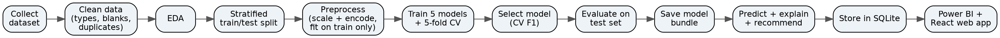{w=6.0}

## 3.5 Use-case diagram

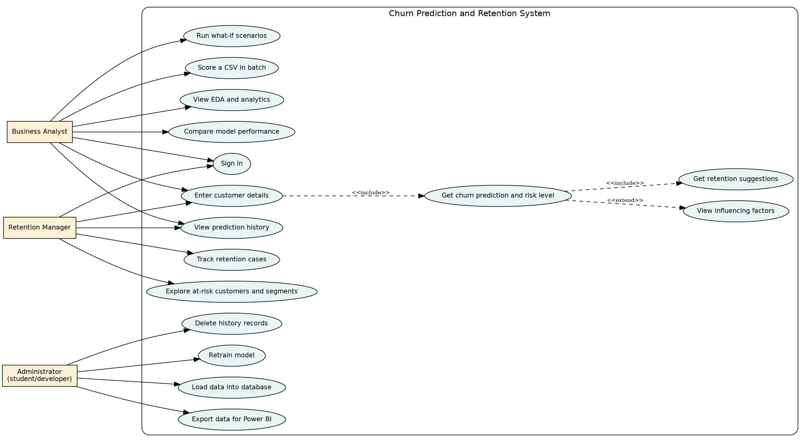{w=5.6}

## 3.6 Data flow diagrams

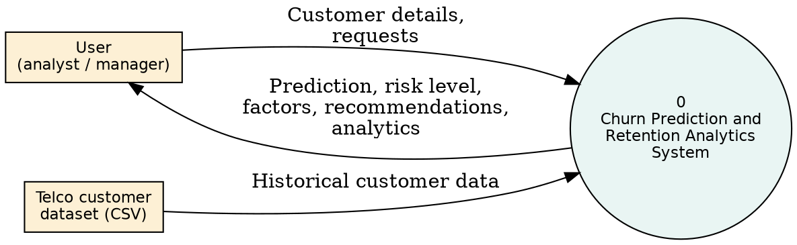{w=5.6}

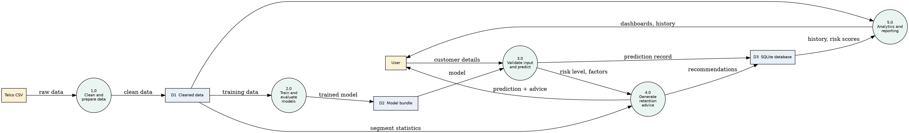{w=6.0}

## 3.7 Database design

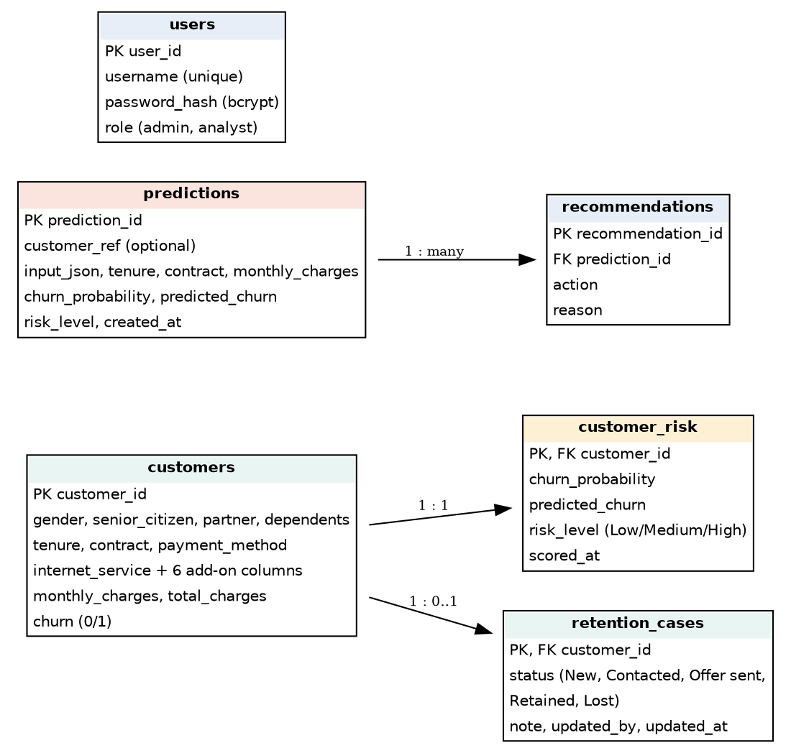{w=5.6}

The `customers` table holds the 7,043 dataset records. `customer_risk` holds the out-of-fold risk score of each customer (one-to-one). `predictions` stores each prediction made in the application together with its explanation, and `recommendations` stores the suggestions for each prediction (one-to-many). `retention_cases` stores the status and notes of the team's work on each at-risk customer, and `users` stores bcrypt-hashed passwords and roles. Foreign keys with cascade delete keep the data consistent, and CHECK constraints reject invalid values such as an unknown risk level.

## 3.8 Project structure

```
churn-project/
├── data/raw, data/processed
├── notebooks/01_eda.ipynb
├── src/ (config, data_loader, preprocessing, eda, train, evaluate,
│         predict, retention, database, score_customers, sql_demo)
├── webapp/ (server: Express API; client: React app)
├── app/app.py (optional Streamlit alternative)
├── database/ (schema.sql, queries.sql, churn.db)
├── models/churn_model.joblib
├── powerbi/ (guide, theme)
├── reports/ (figures, metrics)
├── tests/
└── docs/
```

# Chapter 4: Dataset and Preprocessing

## 4.1 Dataset description

The project uses the IBM Telco Customer Churn sample dataset [17], a public dataset of telecom customers with home phone and internet services. It has 7,043 rows and 21 columns. The target is `Churn` (Yes or No), meaning whether the customer left. The dataset is a sample dataset, so findings may not transfer to a real company.

| Group | Columns |
|---|---|
| Identifier | customerID (not used as a feature) |
| Demographics | gender, SeniorCitizen, Partner, Dependents |
| Account | tenure, Contract, PaperlessBilling, PaymentMethod, MonthlyCharges, TotalCharges |
| Services | PhoneService, MultipleLines, InternetService, OnlineSecurity, OnlineBackup, DeviceProtection, TechSupport, StreamingTV, StreamingMovies |
| Target | Churn |

## 4.2 Data quality findings and cleaning

| Check | Finding | Action |
|---|---|---|
| Duplicate customer IDs | 0 | None needed (duplicate removal is in the code) |
| Ordinary missing values | 0 | None needed |
| TotalCharges data type | Stored as text | Converted to numeric |
| Blank TotalCharges | 11 rows, all with tenure 0 | Set to 0 (new customers not yet billed) |
| SeniorCitizen | Stored as 0 and 1 | Converted to No and Yes |
| Churn | Yes and No | Encoded as 1 and 0 |

All 7,043 rows were kept. Of these, 1,869 customers churned (26.54%) and 5,174 stayed, so the classes are imbalanced.

## 4.3 Train-test split and preprocessing

The data was split into 80% training (5,634 rows, 1,495 churners) and 20% test (1,409 rows, 374 churners). The split is stratified, so both parts have a churn rate of 26.54%, and uses a fixed random seed of 42.

Numeric features (`tenure`, `MonthlyCharges`, `TotalCharges`) are standardised with `StandardScaler`. The 16 categorical features are one-hot encoded with `OneHotEncoder` (binary features keep one column, and unseen categories are ignored at prediction time). The result is 40 model input columns.

## 4.4 Avoiding data leakage

Data leakage occurs when information from the test data influences training. To prevent it, the data is split first. The preprocessing step and the classifier are combined into one scikit-learn `Pipeline`, so the scaler and encoder learn their statistics only from training data, including inside each cross-validation fold. The customer ID and target are never used as features. A test confirms that the scaler's mean equals the training mean and not the full-data mean.

# Chapter 5: Exploratory Data Analysis

All values below were calculated from the dataset. The code is in `notebooks/01_eda.ipynb`.

## 5.1 Overall churn

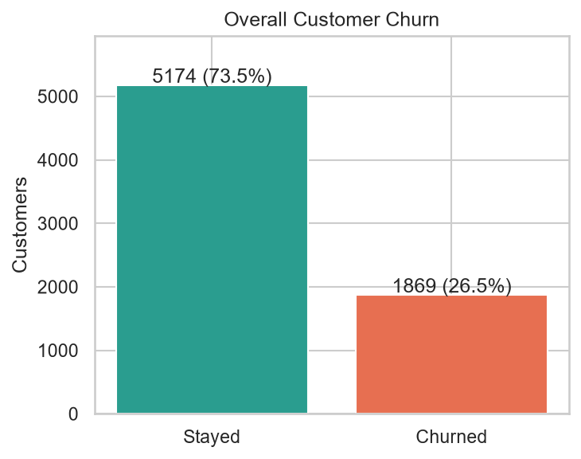{w=3.6}

1,869 of 7,043 customers (26.54%) churned. A model that predicted "stay" for everyone would be correct for about 73.5% of customers and would find no churners, which is why accuracy alone is not suitable here.

## 5.2 Contract type

{w=4.2}

Month-to-month customers churn at 42.71%, one-year customers at 11.27% and two-year customers at 2.83%. Month-to-month customers are 55% of customers but account for 1,655 of the 1,869 churners (about 88.6%).

## 5.3 Tenure

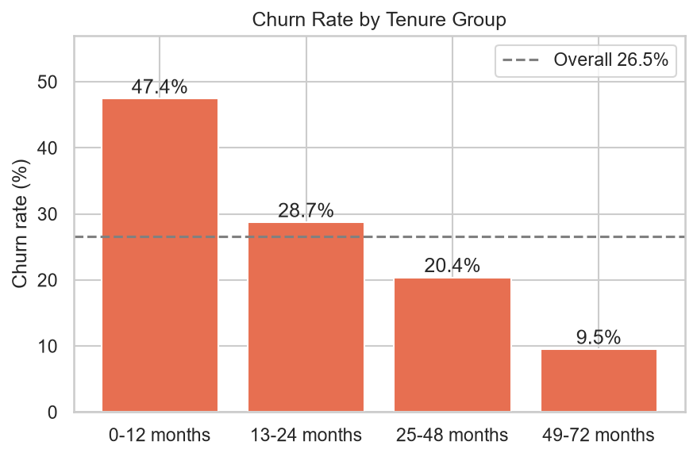{w=4.2}

Churn falls as tenure increases: 47.44% for 0 to 12 months, 28.71% for 13 to 24 months, 20.39% for 25 to 48 months and 9.51% for 49 to 72 months. The median tenure of churned customers is 10 months, compared with 38 months for customers who stayed.

## 5.4 Monthly charges

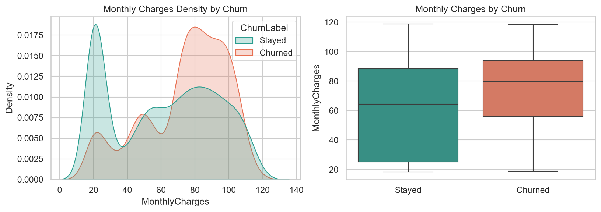{w=5.8}

Churned customers pay more on average (mean 74.44 versus 61.27). Churn by charge band is 10.89% (up to 35), 23.94% (35 to 70), 37.80% (70 to 90) and 32.78% (above 90), so the relationship is not a straight line. The low-charge group is almost entirely customers without internet service (1,526 of 1,653 customers paying 30 or less), who churn the least (7.40%).

## 5.5 Payment method

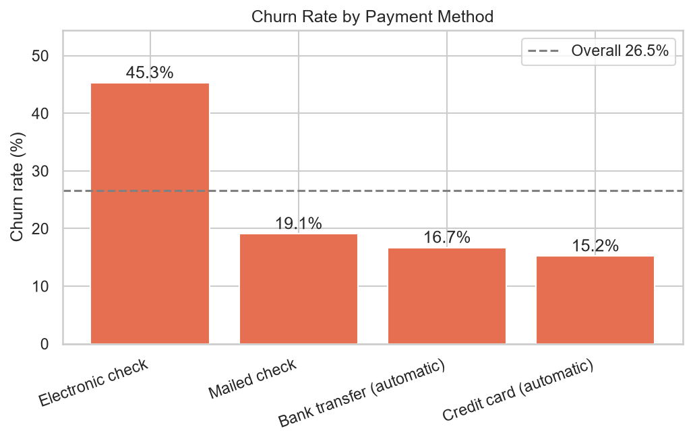{w=4.8}

Electronic check customers churn at 45.29%, compared with 19.11% for mailed check, 16.71% for bank transfer and 15.24% for credit card. This is an association. Electronic check may be linked to other characteristics rather than being a cause.

## 5.6 Internet service and add-on services

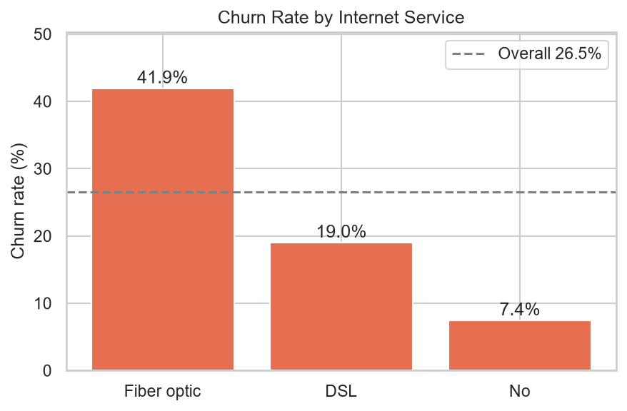{w=4.2}

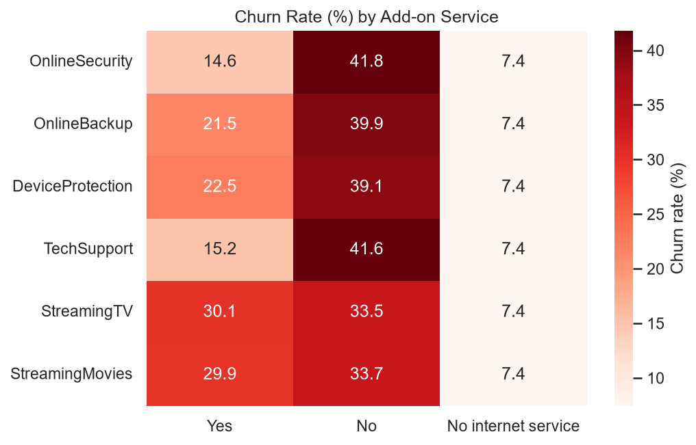{w=4.8}

Fiber optic customers churn at 41.89%, DSL customers at 18.96% and customers without internet at 7.40%. Among internet customers, those without tech support churn at 41.64% (15.17% with it) and those without online security at 41.77% (14.61% with it). Fiber is also the most expensive service (average monthly charge 91.50 versus 58.10 for DSL).

## 5.7 Demographics and billing

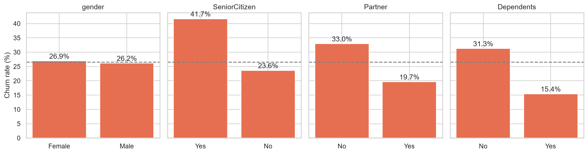{w=6.0}

Gender has almost no effect (female 26.92%, male 26.16%). Senior citizens churn at 41.68% versus 23.61% for others. Customers without a partner churn at 32.96% (19.66% with a partner), and without dependents at 31.28% (15.45% with dependents). Paperless billing customers churn at 33.57% versus 16.33%.

## 5.8 Correlation

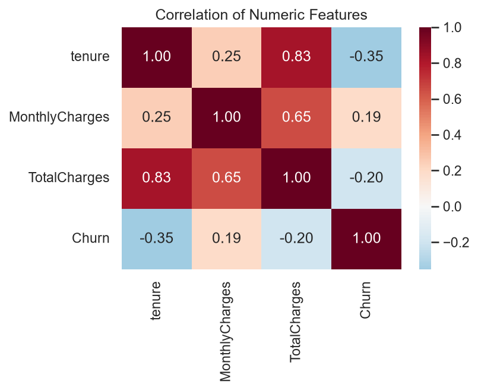{w=3.8}

Tenure has a moderate negative correlation with churn (-0.35), and monthly charges a weak positive one (0.19). Total charges and tenure are strongly correlated (0.83), so they carry overlapping information.

## 5.9 Combined risk factors

The combination of month-to-month contract, fiber optic internet and electronic check payment covers 1,307 customers with a churn rate of 60.37%, and this group contains about 42% of all churners. Even within the first 12 months, month-to-month customers churned at 51.35%, one-year customers at 10.48% and two-year customers at 0% (68 customers).

# Chapter 6: Machine Learning Methodology

## 6.1 Algorithms

**Logistic Regression** models the log-odds of churn as a weighted sum of the inputs. It is simple, fast and easy to interpret, and it acts as a baseline.

**Decision Tree** splits the data using a series of questions on feature values. It is easy to visualise but can overfit if grown too deep, so depth and leaf size were limited.

**Random Forest** [1] builds many decision trees on random samples of data and features and averages their votes, which reduces overfitting.

**Gradient Boosting** [5] builds trees one after another, each correcting the errors of the previous ones.

**XGBoost** [4] is an efficient and regularised implementation of gradient boosting.

## 6.2 Experimental setup

| Setting | Value |
|---|---|
| Train / test split | 80% / 20%, stratified, random seed 42 |
| Cross-validation | 5-fold stratified on the training data, seed 42 |
| Preprocessing | StandardScaler (numeric) + OneHotEncoder (categorical), inside the pipeline |
| Decision threshold | 0.5 |
| Logistic Regression | max_iter 1000, balanced class weights |
| Decision Tree | max depth 5, min samples per leaf 20, balanced class weights |
| Random Forest | 300 trees, max depth 8, min samples per leaf 5, balanced class weights |
| Gradient Boosting | 150 trees, learning rate 0.05, max depth 3, balanced sample weights |
| XGBoost | 300 trees, learning rate 0.05, max depth 3, subsample 0.8, column sample 0.8, scale_pos_weight about 2.77 (ratio of stayers to churners in training data) |

The hyperparameters were set to sensible moderate values. No extensive hyperparameter search was done, which is listed as a limitation.

## 6.3 Handling class imbalance

Class weights make mistakes on churners cost more during training. This avoids a model that ignores churners. For comparison, all models were also trained without any imbalance handling (Section 7.3). Oversampling methods such as SMOTE [3] were not used, to keep the pipeline simple.

## 6.4 Evaluation metrics

- **Accuracy:** share of all predictions that are correct. Misleading when classes are imbalanced.
- **Precision:** of the customers predicted to churn, the share who really churn. Low precision wastes retention effort on customers who would have stayed.
- **Recall:** of the customers who really churn, the share the model finds. Low recall means missed churners, which is costly because the revenue is lost.
- **F1-score:** the harmonic mean of precision and recall.
- **ROC-AUC:** how well the model ranks churners above non-churners across all thresholds, independent of the chosen threshold.
- **Confusion matrix:** counts of true and false positives and negatives.

## 6.5 Model selection rule

The selection rule was fixed before looking at test results: choose the model with the highest mean cross-validated F1-score on the training data. F1 was chosen because both missing churners (recall) and wasting offers (precision) matter. The test set was used only to report final performance.

# Chapter 7: Results and Discussion

All results in this chapter were produced by `python -m src.train`.

## 7.1 Model comparison

| Model | CV F1 | Test accuracy | Test precision | Test recall | Test F1 | Test ROC-AUC |
|---|---|---|---|---|---|---|
| Logistic Regression | 0.629 | 0.738 | 0.504 | 0.783 | 0.614 | 0.842 |
| Decision Tree | 0.616 | 0.755 | 0.527 | 0.757 | 0.621 | 0.832 |
| Random Forest | 0.631 | 0.760 | 0.533 | 0.778 | 0.633 | 0.843 |
| Gradient Boosting | 0.631 | 0.747 | 0.516 | 0.802 | 0.628 | 0.845 |
| XGBoost (selected) | 0.634 | 0.750 | 0.520 | 0.783 | 0.625 | 0.846 |

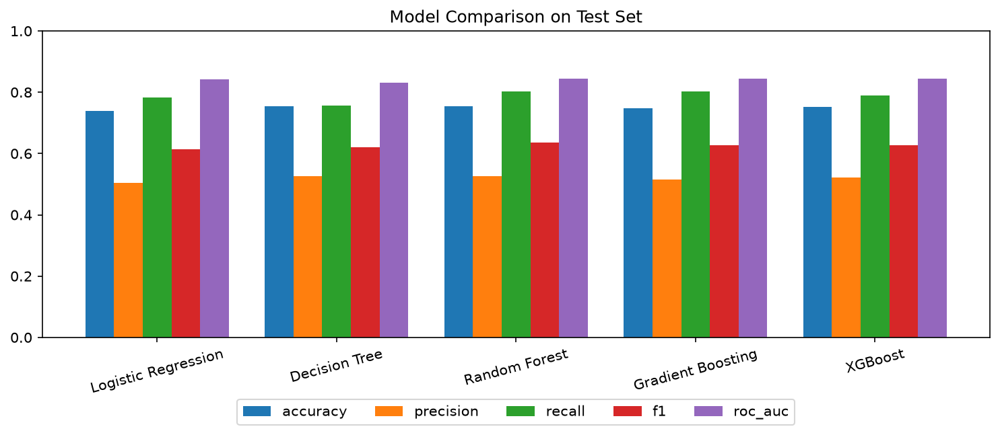{w=5.8}

XGBoost had the highest cross-validated F1 (0.634) and was selected by the rule in Section 6.5. On the test set it reached recall 0.783, precision 0.520, F1 0.625, accuracy 0.750 and ROC-AUC 0.846.

## 7.2 Confusion matrix and ROC curves

{w=6.0}

{w=4.4}

For XGBoost the test confusion matrix is: 764 correctly predicted stayers, 271 stayers wrongly flagged as churners, 81 churners missed, and 293 churners correctly found. In other words, 293 of the 374 churners in the test set were found, and 293 of the 564 flagged customers (51.95%) actually churned.

## 7.3 Effect of class imbalance handling

| Model | Accuracy without balancing | Recall without balancing | Recall with balancing |
|---|---|---|---|
| Logistic Regression | 0.806 | 0.559 | 0.783 |
| Decision Tree | 0.798 | 0.567 | 0.757 |
| Random Forest | 0.808 | 0.519 | 0.778 |
| Gradient Boosting | 0.805 | 0.521 | 0.802 |
| XGBoost | 0.809 | 0.535 | 0.783 |

Without balancing, accuracy is higher (about 0.80 to 0.81) but the models find only about 52% to 57% of churners. With balancing, accuracy falls to about 0.74 to 0.76 but recall rises to about 0.76 to 0.80. Because a missed churner is costly, balancing is preferable for this objective, and this table shows directly why accuracy alone is a poor measure.

## 7.4 Effect of the decision threshold

The table below uses cross-validated predictions on the training data for XGBoost, so the test set was not used to tune the threshold.

| Threshold | Precision | Recall | F1 | Customers flagged (of 5,634) |
|---|---|---|---|---|
| 0.3 | 0.441 | 0.901 | 0.592 | 3,056 |
| 0.4 | 0.482 | 0.854 | 0.616 | 2,650 |
| 0.5 | 0.526 | 0.798 | 0.634 | 2,266 |
| 0.6 | 0.582 | 0.704 | 0.637 | 1,808 |
| 0.7 | 0.646 | 0.569 | 0.605 | 1,317 |

Lowering the threshold finds more churners but flags many more customers, so the best threshold depends on how expensive a retention offer is compared with a lost customer. The project uses 0.5 as the default. A business that knows these costs could choose a different value.

## 7.5 Important features

{w=4.8}

Permutation importance on the test set (drop in ROC-AUC when a feature is shuffled) ranks Contract first (0.073), then tenure (0.045), InternetService (0.010), TotalCharges (0.008) and OnlineSecurity (0.006). This matches the exploratory findings.

## 7.6 Discussion

**The models perform similarly.** Cross-validated F1 ranges from 0.616 to 0.634, and test ROC-AUC from 0.832 to 0.846. The difference in test recall between the best (Gradient Boosting, 0.802) and Logistic Regression (0.783) is about 7 customers out of 374 churners. With a test set of this size such differences may be due to chance, so the results do not prove that XGBoost is better than the others. Logistic Regression is nearly as good and is easier to interpret, so a different priority could justify choosing it.

**Risk groups separate customers well.** Every customer was scored by a model that had not seen that customer (out-of-fold prediction). The resulting groups had actual churn rates of 5.34% (Low, 3,184 customers), 25.39% (Medium, 1,587) and 57.04% (High, 2,272).

**The score is not a calibrated probability.** Because training used class balancing, scores are pushed upward: the High group averages a score of 0.78 but actually churned at 57%. The score is therefore a risk ranking and should not be read as an exact percentage chance of leaving.

**Moderate precision.** At the default threshold about half of the flagged customers actually churn. This is acceptable only if retention offers are inexpensive relative to the cost of losing a customer.

# Chapter 8: Implementation of the Application

## 8.1 Prediction system

The `predict.py` module loads the saved pipeline, validates the input, and returns a result containing the prediction, risk score, risk category, top factors and a disclaimer. The risk category uses these bands (adjustable in `config.py`): Low below 0.30, Medium from 0.30 to below 0.60, and High at 0.60 or above. These bands are a design choice. Their usefulness was checked with the out-of-fold results in Section 7.6.

**Input validation** rejects missing fields, values outside allowed ranges (tenure 0 to 120, monthly charges 0 to 500), categories not in the allowed list, and impossible combinations (for example "multiple lines" for a customer without phone service, or internet add-ons for a customer without internet). If total charges are not given, they are estimated as tenure times monthly charges and the user is told.

## 8.2 Explaining a prediction

For each group of related features, the system replaces the customer's values with values from 100 randomly chosen training customers, predicts again, and averages. The difference from the original score is shown as the effect of that factor in percentage points. Positive values raise risk and negative values lower it. This is easy to explain and works with any model. It is approximate: effects are measured one factor at a time, so they do not add up exactly, and it does not capture interactions between factors. SHAP [16] would be a more rigorous alternative.

## 8.3 Retention module

`retention.py` applies simple rules to the customer's attributes and risk level, and quotes the churn rates measured in the dataset as evidence (Chapter 9). It always ends with a note that the suggestions are to be tested, not proven. It also provides a segment analysis table used in the application and notebook.

## 8.4 Database and SQL

The SQLite schema is in `database/schema.sql` and the analytical queries in `database/queries.sql`. The script `src/sql_demo.py` demonstrates INSERT, SELECT, UPDATE and DELETE on a test customer and runs the queries below, whose outputs match the Python analysis (for example, overall churn of 26.54%).

| Query | Purpose |
|---|---|
| overall_churn_rate | Total customers, churned customers, churn rate |
| churn_by_contract, churn_by_tenure_group, churn_by_payment_method | Churn rate by segment |
| high_risk_segment_contract_internet | Combinations with the highest churn (minimum 100 customers) |
| risk_level_vs_actual_churn | Joins risk scores with actual outcomes |
| retention_target_list | Active customers with High risk, highest monthly charge first |
| monthly_revenue_of_active_customers_by_risk | Monthly revenue by risk level |

The retention target list covers 976 active customers rated High risk with total monthly charges of 73,258.35 (the dataset does not state a currency), out of 316,985.75 for all active customers.

## 8.5 Power BI dashboard

The dashboard reads `data/processed/powerbi_customers.csv`, which contains the cleaned data and out-of-fold risk scores. The build steps, DAX measures (including Total Customers, Churned Customers, Churn Rate, Churn Rate vs Overall, Share of All Churners and Monthly Revenue at Risk), visuals, slicers and expected check values are in `powerbi/POWERBI_GUIDE.md`.

[Insert screenshots of your finished Power BI dashboard here, and describe the insights you observe. Use the check values in the guide to confirm your numbers.]

## 8.6 Web application (React, Node.js and Express)

The main interface is a responsive single-page application built with React and Vite, using the colour palette ice silver (#DDE3E8), deep aubergine (#3A0F34) and gold (#EAAA00). It is served by an Express API that reads and writes SQLite and calls the trained model through a Python worker process started once with the server, so predictions take milliseconds. Light and dark themes are available, the layout switches from a sidebar to a bottom navigation bar on phones, and a Ctrl+K command palette jumps to any page or customer.

| Page | Function |
|---|---|
| Login | JWT sign-in with bcrypt-hashed passwords, rate-limited attempts, admin and analyst roles |
| Dashboard | KPI cards with animated counters, eight SQL-driven charts, and cross-filtering by clicking bars or donut slices |
| Predict | Validated form with dependent fields, animated risk gauge, influencing factors, retention actions, saved result, and a what-if simulator that re-scores live |
| Customers | Server-side search, filters, sorting and pagination, with a detail drawer and model explanation |
| Retention | Queue of active high-risk customers with a status workflow, notes, CSV export and segment analysis |
| Batch scoring | Drag-and-drop CSV upload with row-level validation, risk mix and downloadable scored file |
| Models | Real training results: comparison, imbalance effect, threshold trade-off, importance, ROC and confusion matrices |
| History | Saved predictions with explanation, and deletion |

The REST API is documented in `webapp/README.md`. Security measures include parameterised SQL, a fixed list of sortable columns, security headers (helmet), login rate limiting, token expiry after 12 hours, and server-side validation of every model input with HTTP 422 responses and clear messages. The demonstration accounts and the default signing secret must be changed before any real use.

A simpler Streamlit interface (`app/app.py`) is also included as an alternative.

[Insert screenshots of the dashboard, prediction page with the gauge and what-if simulator, retention queue and mobile view here.]

# Chapter 9: Customer Retention Recommendations

The recommendations below are based on associations in the data. None has been tested in practice, so each should be piloted (for example with an A/B test) before being rolled out widely.

| Customer pattern | Evidence in this dataset | Suggested action | Why it may help | Caution |
|---|---|---|---|---|
| Month-to-month contract | 42.71% churn vs 6.8% for one- and two-year contracts combined | Offer incentives to move to a longer contract | Commitment makes leaving harder | Customers who already intend to leave may take the discount and still leave later |
| Tenure of 12 months or less | 47.44% churn vs 17.1% beyond 12 months | Onboarding programme and early check-ins | The first year is when customers decide | The cost of contacting every new customer must be weighed |
| Electronic check payment | 45.29% vs 16.0% for automatic payments | Encourage automatic payment | Fewer billing frictions | The payment method may only be a marker of other traits |
| No tech support (internet users) | 41.64% vs 15.17% with it | Offer a tech support trial | Customers get help with problems | Customers who take support may differ from those who do not |
| No online security (internet users) | 41.77% vs 14.61% with it | Offer a security or bundle trial | Add-ons increase reliance on the service | Same selection effect as above |
| Fiber optic internet | 41.89% vs 18.96% for DSL | Check service quality and plan fit, review pricing | Fiber is the most expensive plan | The data does not show whether price or quality drives churn |
| Monthly charges in the top 25% | Churn rises with charges up to the 70 to 90 band | Review whether a cheaper plan fits usage | Price sensitivity | Discounts reduce revenue |
| Senior citizens | 41.68% vs 23.61% | Assisted support, simple billing | These customers may need more guidance | Do not assume all seniors need help |

# Chapter 10: Testing

## 10.1 Approach

The project has 63 automated tests, all of which passed in the final run: 43 Python tests (pytest) for the machine learning, database and Streamlit layers, and 20 API tests (Node's built-in test runner) for the Express server. A temporary copy of the database is used so that tests do not change real data. The React interface was additionally exercised in a headless Chromium browser at desktop and phone sizes in light and dark themes, including login, batch scoring, status updates, the customer drawer, the command palette, the what-if simulator and server-side validation messages, with no console errors.

| Area | Tests | What is checked |
|---|---|---|
| Data cleaning | 5 | Duplicates removed, blank total charges handled, correct types, encoding, whitespace |
| Preprocessing | 5 | Split sizes, no row overlap, stratification, no ID or target in features, scaler fitted on training data only, unseen categories |
| Prediction and validation | 14 | Risk boundaries, estimated total charges, invalid inputs rejected, inconsistent combinations rejected, output structure, risky customer scores higher than loyal customer, deterministic output |
| Retention | 5 | Contract suggestion for month-to-month customers, testing note present, low-risk message, evidence uses real data, valid segment rates |
| Database | 7 | Insert and select, save and read prediction, cascade delete, update, unlisted column rejected, constraint rejects invalid risk level, clear history |
| Streamlit application | 7 | All six pages load without error, and a full prediction produces a risk score and the disclaimer |
| Express API | 20 | Authentication, dashboard figures matching the dataset, filters, pagination and sorting, unsafe sort value ignored, prediction saving, 422 validation errors, what-if without saving, customer analysis, batch scoring with bad rows, retention queue and status updates, invalid status rejected, CSV export, segments, model results |

The detailed test cases are in `docs/Testing_Documentation.md`.

## 10.2 Results

All 63 tests passed. A manual run of the React application by the student should also be recorded using the checklist in the testing documentation.

# Chapter 11: Limitations

1. The dataset is a public sample dataset with one snapshot per customer, so it cannot capture changes over time and may not represent a real company.
2. The models perform very similarly, and the test set contains only 374 churners, so small differences are not conclusive.
3. No extensive hyperparameter tuning was done.
4. The risk score is not a calibrated probability because of class balancing.
5. The factor explanations are approximate and are measured one factor at a time.
6. The recommendation rules are fixed rules based on associations, and their effect on churn has not been tested.
7. The costs of retention offers and the value of customers were not modelled, so the decision threshold of 0.5 is not optimised for profit.
8. Fairness was not formally assessed. Senior citizen status is used as a feature and a business should consider whether this is appropriate.
9. The Power BI dashboard must be built manually in Power BI Desktop, and the application runs locally and is not deployed.
10. Authentication is a basic demonstration (two seeded accounts, simple roles) and has not been security audited.

# Chapter 12: Future Scope

- Use SHAP [16] for rigorous, consistent explanations.
- Calibrate the probabilities (for example with isotonic regression) so scores can be read as probabilities.
- Perform hyperparameter tuning and compare imbalance techniques such as SMOTE [3].
- Choose the threshold using customer value and campaign cost, as suggested by profit-driven evaluation [11].
- Run A/B tests to measure the real effect of retention actions.
- Use time-based data so that models learn from customer behaviour over time.
- Deploy the web application online over HTTPS with proper user management, and connect it to a live customer database.
- Test fairness across customer groups.

# Chapter 13: Conclusion

This project built and tested a complete churn prediction and retention analytics system. The data analysis showed that churn is concentrated among month-to-month, short-tenure, electronic-check and fiber optic customers, and among customers without tech support or online security. Five classifiers performed similarly. XGBoost was selected by a pre-defined rule and reached a test recall of 0.783, precision of 0.520 and ROC-AUC of 0.846. Handling class imbalance increased recall for XGBoost from 0.535 to 0.783 at the cost of lower accuracy (0.809 to 0.750), showing that accuracy alone is a misleading measure for churn. The risk categories separated customers well, with actual churn of 5.34%, 25.39% and 57.04% in the Low, Medium and High groups. The React and Express web application, SQLite database and Power BI export turn these results into a usable tool. The system is a prototype built on a public sample dataset, and its predictions and recommendations should be treated as decision support that needs validation before real use.

# References

1. Breiman, L. (2001). Random forests. *Machine Learning*, 45(1), 5-32.
2. Burez, J., and Van den Poel, D. (2009). Handling class imbalance in customer churn prediction. *Expert Systems with Applications*, 36(3), 4626-4636.
3. Chawla, N. V., Bowyer, K. W., Hall, L. O., and Kegelmeyer, W. P. (2002). SMOTE: Synthetic minority over-sampling technique. *Journal of Artificial Intelligence Research*, 16, 321-357.
4. Chen, T., and Guestrin, C. (2016). XGBoost: A scalable tree boosting system. *Proceedings of the 22nd ACM SIGKDD International Conference on Knowledge Discovery and Data Mining*, 785-794.
5. Friedman, J. H. (2001). Greedy function approximation: A gradient boosting machine. *Annals of Statistics*, 29(5), 1189-1232.
6. Hadden, J., Tiwari, A., Roy, R., and Ruta, D. (2007). Computer assisted customer churn management: State-of-the-art and future trends. *Computers and Operations Research*, 34(10), 2902-2917.
7. Neslin, S. A., Gupta, S., Kamakura, W., Lu, J., and Mason, C. H. (2006). Defection detection: Measuring and understanding the predictive accuracy of customer churn models. *Journal of Marketing Research*, 43(2), 204-211.
8. Pedregosa, F., et al. (2011). Scikit-learn: Machine learning in Python. *Journal of Machine Learning Research*, 12, 2825-2830.
9. Reichheld, F. F., and Sasser, W. E. (1990). Zero defections: Quality comes to services. *Harvard Business Review*, 68(5), 105-111.
10. Saito, T., and Rehmsmeier, M. (2015). The precision-recall plot is more informative than the ROC plot when evaluating binary classifiers on imbalanced datasets. *PLOS ONE*, 10(3), e0118432.
11. Verbeke, W., Dejaeger, K., Martens, D., Hur, J., and Baesens, B. (2012). New insights into churn prediction in the telecommunication sector: A profit driven data mining approach. *European Journal of Operational Research*, 218(1), 211-229.
12. Verbeke, W., Martens, D., Mues, C., and Baesens, B. (2011). Building comprehensible customer churn prediction models with advanced rule induction techniques. *Expert Systems with Applications*, 38(3), 2354-2364.
13. Vafeiadis, T., Diamantaras, K. I., Sarigiannidis, G., and Chatzisavvas, K. C. (2015). A comparison of machine learning techniques for customer churn prediction. *Simulation Modelling Practice and Theory*, 55, 1-9.
14. Ahmad, A. K., Jafar, A., and Aljoumaa, K. (2019). Customer churn prediction in telecom using machine learning in big data platform. *Journal of Big Data*, 6, Article 28.
15. Fawcett, T. (2006). An introduction to ROC analysis. *Pattern Recognition Letters*, 27(8), 861-874.
16. Lundberg, S. M., and Lee, S.-I. (2017). A unified approach to interpreting model predictions. *Advances in Neural Information Processing Systems 30*, 4765-4774.
17. IBM. Telco Customer Churn sample dataset (IBM sample data, also available on Kaggle). Accessed [date].

# Appendix A: How to Run the Project

```
python -m venv venv
venv\Scripts\activate
pip install -r requirements.txt
python run_pipeline.py
cd webapp
npm run setup
npm run build
npm start
```

Then open http://localhost:3001 and sign in with admin / admin123.

# Appendix B: Source Files

| File | Purpose |
|---|---|
| src/config.py | Paths, column lists, constants |
| src/data_loader.py | Loading and cleaning |
| src/preprocessing.py | Split and preprocessing pipeline |
| src/eda.py | EDA plots and tables |
| src/train.py, src/evaluate.py | Training, comparison, metrics, plots |
| src/predict.py | Validation, prediction, explanation |
| src/retention.py | Recommendations and segment analysis |
| src/database.py, database/schema.sql | Database access and schema |
| src/score_customers.py | Out-of-fold scoring and Power BI export |
| src/sql_demo.py, database/queries.sql | SQL demonstration |
| webapp/server/*.js | Express API, authentication, SQLite access, Python worker bridge |
| webapp/client/src | React pages, charts and styles |
| src/ml_worker.py | Long-running model worker used by the API |
| app/app.py | Optional Streamlit alternative |
