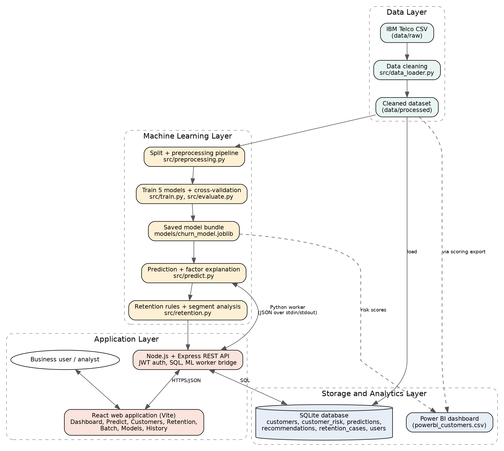

@center:16:b AI-Based Customer Churn Prediction and Retention Analytics Using Machine Learning
@center:12 [Student Name], Reeti Jaswal (E13367), Palwinder Kaur Mangat (E9422)
@center:11 [Department], [University / Institute], [Email]
@space
<<NEWSECTION>>
## Abstract

Customer churn is a costly problem for subscription businesses. This paper presents an end-to-end system that predicts churn, explains the main drivers of each prediction and links the result to retention actions. Using the public IBM Telco Customer Churn dataset (7,043 customers, 26.54% churn), five classifiers (Logistic Regression, Decision Tree, Random Forest, Gradient Boosting and XGBoost) were compared with 5-fold stratified cross-validation and a held-out 20% test set, with class weights used to handle imbalance. The models performed similarly. XGBoost, selected by the highest cross-validated F1-score, reached a test recall of 0.783, precision of 0.520, F1-score of 0.625 and ROC-AUC of 0.846. Handling imbalance raised its recall from 0.535 to 0.783 while lowering accuracy from 0.809 to 0.750. Churn was most strongly associated with month-to-month contracts, short tenure, electronic-check payment, fiber optic internet and the absence of tech support or online security. Out-of-fold risk groups showed actual churn of 5.34%, 25.39% and 57.04% for Low, Medium and High risk. The system is implemented as a React web application with a Node.js and Express API, SQLite storage and a Power BI export. Retention recommendations are derived from associations and have not been tested experimentally.

**Keywords:** customer churn, classification, XGBoost, class imbalance, retention analytics

## 1. Introduction

Customer churn is the loss of customers who stop using a company's service. Retaining customers is closely tied to profitability [9], so companies try to identify customers at risk early. Machine learning can learn churn patterns from historical records, but a prediction is more useful when it is accompanied by an explanation and a suggested action. This paper describes a complete prototype that provides both, built as an MCA minor project.

## 2. Problem Statement

Given customer account, service and demographic attributes, predict whether a customer will churn, estimate a risk level, identify the factors that influence the prediction, and suggest actions that a business could test to retain high-risk customers.

## 3. Aim and Objectives

The aim is to build a reproducible churn prediction and retention analytics system. The objectives are: (1) prepare the data without leakage; (2) analyse churn patterns; (3) compare five classifiers using metrics suited to imbalanced data; (4) provide a prediction interface with risk categories and explanations; (5) generate evidence-based retention suggestions; (6) store results in a relational database; and (7) present findings in a dashboard and web application.

## 4. Literature Review

Reichheld and Sasser [9] linked customer retention to profit, and Hadden et al. [6] reviewed computer-assisted churn management. Neslin et al. [7] studied the predictive accuracy of churn models on a common dataset. Vafeiadis et al. [13] compared several machine learning techniques for telecom churn and examined boosting, and Ahmad et al. [14] reported good results for tree-based ensembles, including XGBoost, on a telecom big data platform. Burez and Van den Poel [2] examined class imbalance in churn prediction, Chawla et al. [3] proposed SMOTE, and Saito and Rehmsmeier [10] showed that precision-recall plots can be more informative than ROC plots for imbalanced data. Verbeke et al. [11] argued for profit-driven evaluation, and Verbeke et al. [12] emphasised comprehensible models. The algorithms used here are random forests [1], gradient boosting [5] and XGBoost [4]. Lundberg and Lee [16] proposed SHAP for explanation.

This section describes published work in general terms. The experiments reported below are the authors' own.

## 5. Research Gap

Much published work concentrates on comparing the accuracy of algorithms. In the studies reviewed here, the integration of prediction, explanation, evidence-based retention advice, database storage, business-intelligence reporting and a usable interface receives less attention. This work addresses that integration at prototype scale. The statement is based on the selected studies and is not a claim that no such system exists.

## 6. Proposed Methodology

The workflow is: data cleaning, exploratory analysis, stratified train-test split, preprocessing and training inside a single pipeline, model comparison by cross-validation, selection by a pre-defined rule, evaluation on the held-out test set, and deployment of the saved pipeline in a web application that also writes to a database.

## 7. Dataset Description

The IBM Telco Customer Churn sample dataset [17] has 7,043 customers and 21 attributes: demographics (gender, senior citizen, partner, dependents), account information (tenure, contract, paperless billing, payment method, monthly and total charges) and services (phone, multiple lines, internet service and six add-ons). The target is Churn. Eleven blank `TotalCharges` values, all for customers with zero tenure, were set to 0. No duplicates were found. In total, 1,869 customers (26.54%) churned.

## 8. System Architecture and Workflow

The system has data, machine learning, storage and presentation layers (Figure 1). Data cleaning and preprocessing produce a pipeline that is saved after training. A prediction module validates input, scores the customer and explains the score. A retention module converts the result into suggestions. Predictions are stored in SQLite, out-of-fold scores are exported for Power BI, and a React web application served by a Node.js and Express API connects all parts, calling the saved model through a Python worker process.

{w=5.6}

## 9. Exploratory Data Analysis

Churn was 42.71% for month-to-month, 11.27% for one-year and 2.83% for two-year contracts. By tenure group it was 47.44% (0-12 months), 28.71% (13-24), 20.39% (25-48) and 9.51% (49-72). Electronic-check customers churned at 45.29%, against 15.24% to 19.11% for other methods. Fiber optic customers churned at 41.89% (DSL 18.96%, no internet 7.40%). Among internet customers, churn was 41.64% without tech support and 15.17% with it. Gender made almost no difference (26.92% and 26.16%). Month-to-month, fiber optic, electronic-check customers (1,307 customers) churned at 60.37% and contained about 42% of all churners.

{w=3.6}

## 10. Machine Learning Algorithms

Logistic Regression is a linear baseline. A depth-limited Decision Tree gives an interpretable model. Random Forest [1] averages many trees. Gradient Boosting [5] and XGBoost [4] add trees sequentially to correct earlier errors.

## 11. Experimental Setup

The data was split 80/20 with stratification and seed 42 (5,634 training and 1,409 test rows). Numeric features were standardised and categorical features one-hot encoded inside a scikit-learn pipeline [8] so that preprocessing learned from training data only. Class imbalance was handled with balanced class weights (scale_pos_weight of about 2.77 for XGBoost, sample weights for Gradient Boosting). Hyperparameters were moderate fixed values without extensive tuning. The model with the highest mean 5-fold cross-validated F1 on the training data was selected, and the decision threshold was 0.5.

## 12. Results and Comparison

| Model | CV F1 | Accuracy | Precision | Recall | F1 | ROC-AUC |
|---|---|---|---|---|---|---|
| Logistic Regression | 0.629 | 0.738 | 0.504 | 0.783 | 0.614 | 0.842 |
| Decision Tree | 0.616 | 0.755 | 0.527 | 0.757 | 0.621 | 0.832 |
| Random Forest | 0.631 | 0.760 | 0.533 | 0.778 | 0.633 | 0.843 |
| Gradient Boosting | 0.631 | 0.747 | 0.516 | 0.802 | 0.628 | 0.845 |
| XGBoost | 0.634 | 0.750 | 0.520 | 0.783 | 0.625 | 0.846 |

Test-set metrics are shown except the first column. For XGBoost the confusion matrix was 764 true negatives, 271 false positives, 81 false negatives and 293 true positives. Without imbalance handling, accuracy was 0.798 to 0.809 but recall only 0.519 to 0.567 across the five models. Permutation importance ranked Contract (0.073 drop in ROC-AUC) and tenure (0.045) far above all other features. Scoring every customer with a model that had not seen that customer produced risk groups with actual churn of 5.34% (Low, 3,184 customers), 25.39% (Medium, 1,587) and 57.04% (High, 2,272).

{w=3.8}

## 13. Discussion

The five models were close, and the difference between the best and worst test recall among the three strongest corresponds to about seven of 374 churners, so the ranking is not conclusive. A simple model such as Logistic Regression is nearly as good and easier to explain. The accuracy results show why recall must be considered: models without imbalance handling had the highest accuracy but missed almost half of churners. Because balancing inflates scores, the output is a risk ranking and not a calibrated probability (the High group averages a score of 0.78 but churned at 57%). At the 0.5 threshold about half of flagged customers actually churned, so retention offers should be inexpensive relative to the value of a lost customer.

## 14. Customer Retention Recommendations

Based on the associations found, a business could test: incentives to move month-to-month customers to longer contracts; onboarding support during the first year; encouraging automatic payment instead of electronic check; trials of tech support and online security for internet customers; and a review of plan fit and pricing for fiber optic and high-bill customers. These suggestions are hypotheses. A/B testing is needed before claiming any effect on churn.

## 15. Limitations

The dataset is a public sample with a single snapshot per customer. The test set has only 374 churners. Hyperparameters were not extensively tuned. Scores are not calibrated, explanations are approximate one-factor-at-a-time effects, the retention rules are untested, retention costs were not modelled, and fairness was not assessed.

## 16. Future Scope

SHAP explanations [16], probability calibration, hyperparameter tuning, SMOTE [3] comparison, profit-driven threshold selection [11], A/B testing of retention actions, time-based data, fairness testing and online deployment.

## 17. Conclusion

A complete churn prediction and retention analytics prototype was built and evaluated on a public dataset. XGBoost reached a test recall of 0.783 and ROC-AUC of 0.846, although the five models performed similarly. Contract type and tenure were the dominant factors. The results are decision support for further testing and not proof of what actions reduce churn.

## References

1. L. Breiman, "Random forests," Machine Learning, vol. 45, no. 1, pp. 5-32, 2001.
2. J. Burez and D. Van den Poel, "Handling class imbalance in customer churn prediction," Expert Systems with Applications, vol. 36, no. 3, pp. 4626-4636, 2009.
3. N. V. Chawla, K. W. Bowyer, L. O. Hall and W. P. Kegelmeyer, "SMOTE: Synthetic minority over-sampling technique," Journal of Artificial Intelligence Research, vol. 16, pp. 321-357, 2002.
4. T. Chen and C. Guestrin, "XGBoost: A scalable tree boosting system," in Proc. 22nd ACM SIGKDD Int. Conf. Knowledge Discovery and Data Mining, 2016, pp. 785-794.
5. J. H. Friedman, "Greedy function approximation: A gradient boosting machine," Annals of Statistics, vol. 29, no. 5, pp. 1189-1232, 2001.
6. J. Hadden, A. Tiwari, R. Roy and D. Ruta, "Computer assisted customer churn management: State-of-the-art and future trends," Computers and Operations Research, vol. 34, no. 10, pp. 2902-2917, 2007.
7. S. A. Neslin, S. Gupta, W. Kamakura, J. Lu and C. H. Mason, "Defection detection: Measuring and understanding the predictive accuracy of customer churn models," Journal of Marketing Research, vol. 43, no. 2, pp. 204-211, 2006.
8. F. Pedregosa et al., "Scikit-learn: Machine learning in Python," Journal of Machine Learning Research, vol. 12, pp. 2825-2830, 2011.
9. F. F. Reichheld and W. E. Sasser, "Zero defections: Quality comes to services," Harvard Business Review, vol. 68, no. 5, pp. 105-111, 1990.
10. T. Saito and M. Rehmsmeier, "The precision-recall plot is more informative than the ROC plot when evaluating binary classifiers on imbalanced datasets," PLOS ONE, vol. 10, no. 3, e0118432, 2015.
11. W. Verbeke, K. Dejaeger, D. Martens, J. Hur and B. Baesens, "New insights into churn prediction in the telecommunication sector: A profit driven data mining approach," European Journal of Operational Research, vol. 218, no. 1, pp. 211-229, 2012.
12. W. Verbeke, D. Martens, C. Mues and B. Baesens, "Building comprehensible customer churn prediction models with advanced rule induction techniques," Expert Systems with Applications, vol. 38, no. 3, pp. 2354-2364, 2011.
13. T. Vafeiadis, K. I. Diamantaras, G. Sarigiannidis and K. C. Chatzisavvas, "A comparison of machine learning techniques for customer churn prediction," Simulation Modelling Practice and Theory, vol. 55, pp. 1-9, 2015.
14. A. K. Ahmad, A. Jafar and K. Aljoumaa, "Customer churn prediction in telecom using machine learning in big data platform," Journal of Big Data, vol. 6, article 28, 2019.
15. T. Fawcett, "An introduction to ROC analysis," Pattern Recognition Letters, vol. 27, no. 8, pp. 861-874, 2006.
16. S. M. Lundberg and S.-I. Lee, "A unified approach to interpreting model predictions," in Advances in Neural Information Processing Systems 30, 2017, pp. 4765-4774.
17. IBM, "Telco Customer Churn" sample dataset, accessed [date].
